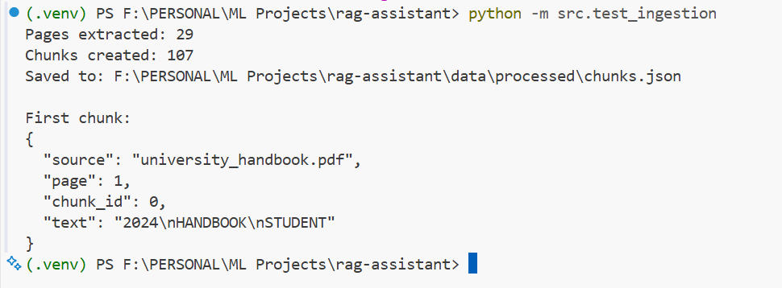
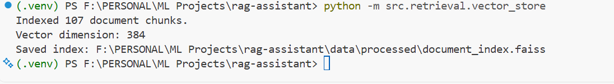

# RAG Assistant

A locally developed Retrieval-Augmented Generation (RAG) project: PDF
text extraction, chunking, embeddings, FAISS retrieval, grounded answer
generation through Groq, a FastAPI backend, and a Next.js web interface
(DocuMind).

## Project Status

-   [x] Local Python virtual environment
-   [x] PDF text extraction with PyMuPDF
-   [x] Character-based chunking with overlap
-   [x] Text embeddings with Sentence Transformers
-   [x] Vector similarity index with FAISS
-   [x] Semantic search over document chunks
-   [x] LLM-based answer generation
-   [x] FastAPI backend
-   [x] Web interface (chat, sources; no upload yet)
-   [ ] Retrieval evaluation and deployment

## Architecture So Far

``` text
PDF document
    |
    v
PyMuPDF: extract text page by page
    |
    v
Chunking: split text into overlapping chunks
    |
    v
chunks.json
    |
    v
Sentence Transformers: create embeddings
    |
    +--> embeddings.npy
    +--> embedding_metadata.json
    |
    v
FAISS IndexFlatIP vector index
    |
    v
User question --> query embedding --> similarity search
                                      |
                                      v
                              Top-k relevant chunks
```

Retrieved passages are then passed to an LLM to generate the answer
(section 7). The web app (section 8) sits on top of that.

## Technology Stack

-   **Python** --- primary language
-   **venv** --- isolated local Python environment
-   **PyMuPDF** --- extracts text from PDF pages
-   **Sentence Transformers** --- creates text embeddings using
    `sentence-transformers/all-MiniLM-L6-v2`
-   **NumPy** --- stores and handles embedding arrays
-   **FAISS CPU** --- performs vector similarity search

## Project Structure

The current project structure is expected to look like this:

``` text
rag-assistant/
├── .venv/
├── data/
│   ├── raw/
│   │   └── university_handbook.pdf
│   └── processed/
│       ├── chunks.json
│       ├── embeddings.npy
│       ├── embedding_metadata.json
│       └── document_index.faiss
├── src/
│   ├── __init__.py
│   ├── test_ingestion.py
│   └── ingestion/
│       ├── __init__.py
│       └── pdf_loader.py
│   └── retrieval/
│       ├── __init__.py
│       ├── embeddings.py
│       ├── vector_store.py
│       └── search.py
├── tests/
├── requirements.txt
└── README.md
```

> The PDF filename shown above is an example. Replace it with the
> filename you actually use. Keep private or copyrighted documents out
> of public repositories unless you have permission to share them.

## 1. Create and Activate the Virtual Environment

On Windows PowerShell:

``` powershell
mkdir rag-assistant
cd rag-assistant
py -m venv .venv
.\.venv\Scripts\Activate.ps1
python -m pip install --upgrade pip
```

If PowerShell blocks activation, allow scripts for the current terminal
session only:

``` powershell
Set-ExecutionPolicy -Scope Process -ExecutionPolicy Bypass
.\.venv\Scripts\Activate.ps1
```

Verify that Python points to the project's `.venv` directory:

``` powershell
python --version
python -c "import sys; print(sys.executable)"
```

## 2. Install Dependencies

Install the PDF processing dependency:

``` powershell
python -m pip install pymupdf
```

After creating the ingestion pipeline, install the embedding and vector
search dependencies:

``` powershell
python -m pip install sentence-transformers faiss-cpu numpy
```

Update the dependency file:

``` powershell
python -m pip freeze > requirements.txt
```

To install the saved dependencies in another environment later:

``` powershell
python -m pip install -r requirements.txt
```

## 3. PDF Text Extraction and Chunking

**File:** `src/ingestion/pdf_loader.py`

The ingestion module contains two functions:

-   `extract_pages(pdf_path)` opens a PDF and extracts text page by
    page. Each extracted page retains the source filename and page
    number.
-   `chunk_pages(pages, chunk_size=1000, overlap=150)` splits page text
    into smaller, overlapping chunks.

Each chunk contains:

-   `source` --- original PDF filename
-   `page` --- one-based page number
-   `chunk_id` --- chunk identifier
-   `text` --- extracted chunk text

The initial chunking method uses character counts. This is a simple
baseline; token-aware or structure-aware chunking can be evaluated
later. Empty pages are skipped. A PDF with no extractable text may be
scanned and require OCR.

### Run the ingestion pipeline

Place a PDF in `data/raw/` and update the PDF filename in
`src/test_ingestion.py` if necessary. Then run from the project root:

``` powershell
python -m src.test_ingestion
```

The script reports the number of extracted pages and generated chunks,
prints the first chunk, and writes the chunks to
`data/processed/chunks.json`.

### Screenshot: PDF ingestion output

Save the terminal output showing successful extraction and chunk
creation here:

`docs/screenshots/03-pdf-ingestion.png`



## 4. Generate Embeddings

**File:** `src/retrieval/embeddings.py`

The embedding pipeline:

1.  Loads `data/processed/chunks.json`.
2.  Extracts the text from each chunk.
3.  loads the `sentence-transformers/all-MiniLM-L6-v2` pretrained model.
4.  Encodes each chunk into a numerical vector.
5.  Normalizes the vectors and saves them as `float32`.
6.  Saves the vectors and associated chunk metadata.

Run it from the project root:

``` powershell
python -m src.retrieval.embeddings
```

Expected output files:

-   `data/processed/embeddings.npy` --- embedding matrix
-   `data/processed/embedding_metadata.json` --- model name, embedding
    dimension, chunk count, and chunk metadata

The model produces 384-dimensional vectors. If there are `N` chunks, the
expected embedding matrix shape is `(N, 384)`. The actual chunk count
depends on the PDF.

## 5. Build the FAISS Vector Index

**File:** `src/retrieval/vector_store.py`

The vector-store module loads `embeddings.npy` and creates a FAISS
`IndexFlatIP` index. Since the embeddings are normalized, inner-product
scores correspond to cosine similarity.

This index performs exact similarity search and is suitable as an
initial implementation for a small document collection.

Run:

``` powershell
python -m src.retrieval.vector_store
```

The index is saved to:

`data/processed/document_index.faiss`

### Screenshot: FAISS index creation

Save the terminal output showing the number of indexed chunks and vector
dimension here:

`docs/screenshots/06-faiss-index.png`



## 6. Search Documents Semantically

**File:** `src/retrieval/search.py`

The semantic-search module:

1.  Accepts a question from the terminal.
2.  Embeds the question using the same embedding model.
3.  Loads the FAISS index.
4.  Retrieves the top `k` matching chunks.
5.  Prints each result's similarity score, source filename, page number,
    and text.

Run:

``` powershell
python -m src.retrieval.search
```

Enter a question that the PDF is expected to answer. Type `exit` or
`quit` to close the search loop.

For example, if a handbook contains fee payment rules, ask a question
about when fees must be paid. Use questions that genuinely relate to
your own document.

**Important:** similarity scores are ranking signals, not calibrated
confidence values. A high score does not guarantee that a passage
answers the question. Check the returned passages manually.

### Screenshot: Semantic search results

Save a screenshot showing a query and its retrieved passages here:

`docs/screenshots/07-semantic-search.png`


## Generated Files

  -----------------------------------------------------------------------
  File                                Purpose
  ----------------------------------- -----------------------------------
  `chunks.json`                       Extracted and chunked document text
                                      with source/page metadata

  `embeddings.npy`                    Numerical vector for each chunk

  `embedding_metadata.json`           Embedding model information and
                                      chunk metadata

  `document_index.faiss`              FAISS index used for similarity
                                      search

  `requirements.txt`                  Python dependency versions
  -----------------------------------------------------------------------


## 7. LLM Integration and Answer Generation

**File:** `src/generation/answer_generator.py`

The answer-generation module connects the existing semantic retrieval pipeline to a hosted large language model through the Groq API.

### Workflow

1. Accept a user's question.
2. Retrieve the most relevant document chunks through FAISS.
3. Attach source filenames and page numbers to the retrieved excerpts.
4. Construct a prompt containing the question and retrieved evidence.
5. Send the prompt to the configured LLM.
6. Return the generated answer and the retrieved source metadata.

### Configuration

Create a `.env` file in the project root:

```env
GROQ_API_KEY=your_actual_api_key_here
GROQ_MODEL=openai/gpt-oss-20b
```

Never commit `.env` or expose API keys in screenshots or public repositories.

### Run the RAG assistant

With the virtual environment activated, run:

```powershell
python -m src.generation.answer_generator
```

Test answerable questions, paraphrased questions, and questions that cannot be answered from the documents.

### Current limitations

- The model may still generate unsupported statements despite the grounding instructions.
- Source labels need to be checked against the claims in the answer.
- Retrieval quality and answer correctness have not yet been formally evaluated.

### Screenshot

Save a screenshot of an actual question, generated answer, and retrieved sources to:

`docs/screenshots/08-llm-answer-generation.png`
`docs/screenshots/08-llm-answer-generation2.png`
`docs/screenshots/08-llm-answer-generation3.png`

Ensure the screenshot does not expose your API key or other secrets.


## 8. Web Application (FastAPI + Next.js)

```text
Browser (Next.js, frontend/)  --HTTP/JSON-->  FastAPI (src/api/)  -->  generate_answer()
                                                                       -> search_documents() -> FAISS
                                                                       -> Groq (key stays server-side)
```

-   **Backend** `src/api/main.py` is a thin layer. It calls the existing
    `generate_answer()` and reads `embedding_metadata.json`; it does not
    duplicate pipeline logic. `src/api/schemas.py` holds the Pydantic models.
-   **Frontend** `frontend/` uses Next.js (App Router), TypeScript, Tailwind CSS
    and shadcn/ui. API calls live in `frontend/src/lib/api.ts`; the product
    name is set in `frontend/src/lib/config.ts` (`APP_NAME`).
    Conversations are held in memory and are lost on reload.

### Install

```powershell
# Backend (venv activated)
python -m pip install -r requirements.txt -r requirements-api.txt

# Frontend
cd frontend
npm install
```

### Configure

| File | Variable | Purpose |
|------|----------|---------|
| `.env` (root) | `GROQ_API_KEY`, `GROQ_MODEL` | LLM access. Server-side only. |
| `.env` (root) | `FRONTEND_ORIGINS` | Optional CORS allow-list. Default: `http://localhost:3000`, `http://127.0.0.1:3000` |
| `frontend/.env.local` | `NEXT_PUBLIC_API_BASE_URL` | Backend URL. Default `http://localhost:8000` |

Templates: `.env.example` and `frontend/.env.example` (placeholders only).
`NEXT_PUBLIC_*` values are exposed to the browser; never put secrets there.

### Run (two terminals)

```powershell
# 1. Backend, from the project root
uvicorn src.api.main:app --reload --port 8000

# 2. Frontend
cd frontend
npm run dev        # http://localhost:3000
```

The first chat request is slow because `search_documents()` loads the
embedding model on every call (existing behavior, not changed).

### API

| Method | Path | Description |
|--------|------|-------------|
| GET | `/api/health` | Status, whether the index exists, whether a Groq key is configured |
| GET | `/api/documents` | Indexed documents with page/chunk counts, derived from `embedding_metadata.json` |
| POST | `/api/chat` | Body `{"question": str (1-2000 chars), "top_k": int 1-20 (default 5)}`. Returns `{answer, sources[{label, document, page, similarity, text}], model}` |

Errors: `422` invalid input, `503` index missing or LLM not configured,
`502` generation failed. Interactive docs: `http://localhost:8000/docs`.

### Web app limitations

-   **No browser upload.** Ingestion (`src/test_ingestion.py`) is hardcoded to one
    PDF and overwrites `chunks.json`; embeddings and the FAISS index are rebuilt
    from scratch. Safe multi-document upload needs per-document chunk storage
    and an index rebuild step, which is a separate change. To add documents
    today, use the command-line pipeline.
-   Responses are not streamed and generation cannot be cancelled, so the UI has
    no stop button.
-   Conversations are not persisted and are not sent to the model as history:
    each question is answered independently.
-   The `sim` value on each source is cosine similarity, not a confidence score.
-   Single-user local use only; no authentication or rate limiting.

## Current Limitations

-   Retrieval quality has not yet been measured against a labelled
    evaluation dataset.
-   Character-based chunking may split sentences or sections awkwardly.
-   Scanned PDFs may need OCR.
-   Similarity scores do not directly represent the probability that a
    result is correct.
-   The initial implementation is designed for local experimentation,
    not yet for multi-user production use.
-   The embedding model name is currently specified in more than one
    module; it should be centralized in configuration as the project
    grows.

## Next Steps

1.  Test semantic search with several questions grounded in the PDF.
2.  Review whether the retrieved passages actually support each
    question.
3.  Build a small retrieval evaluation dataset with expected supporting
    passages.
4.  Add LLM-based answer generation using retrieved chunks as context.
5.  Include source citations in answers and handle questions that cannot
    be answered from the documents.
6.  Add a FastAPI endpoint and a web interface.
7.  Evaluate the complete RAG pipeline and document its limitations.

## Screenshot Guide

Create this folder in the repository and place your actual screenshots
inside it:

``` text
docs/
└── screenshots/
    ├── 03-pdf-ingestion.png
    ├── 06-faiss-index.png
    └── 07-semantic-search.png
```

The screenshot paths in this README are placeholders until you add your
captured images. GitHub will display them when the files exist at those
paths. Use screenshots of your actual terminal and output; do not
replace them with fabricated results.

## Running Order

From the project root, with the virtual environment activated:

``` powershell
python -m src.test_ingestion
python -m src.retrieval.embeddings
python -m src.retrieval.vector_store
python -m src.retrieval.search
```

Re-run ingestion whenever the source PDF or chunking configuration
changes, then regenerate embeddings and rebuild the index so all
artifacts stay in sync.
